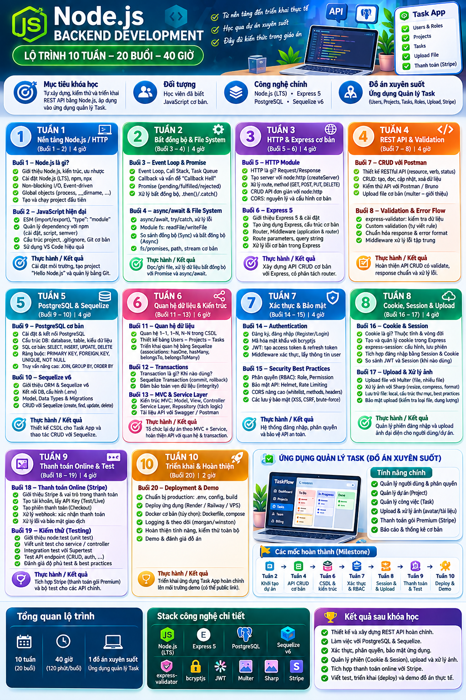

# Training_NodeJS

Training Node.js for newbie — **Node.js Backend Development**: lộ trình **10 tuần – 20 buổi – 40 giờ**.

## Giới thiệu khóa học

| | |
|---|---|
| **Mục tiêu** | Tự xây dựng, kiểm thử và triển khai REST API bằng Node.js, áp dụng vào ứng dụng quản lý task. |
| **Đối tượng** | Học viên đã biết JavaScript cơ bản. |
| **Công nghệ chính** | Node.js (LTS), Express 5, PostgreSQL, Sequelize v6 |
| **Đồ án xuyên suốt** | Ứng dụng Quản lý Task (Users, Projects, Tasks, Roles, Upload, Stripe) |

Đặc điểm: đi từ nền tảng đến triển khai thực tế · học qua dự án xuyên suốt · đầy đủ kiến thức trong giáo án.

## Tổng quan lộ trình

| Tuần | Chủ đề | Buổi | Thời lượng |
|:---:|---|:---:|:---:|
| 1 | Nền tảng Node.js / HTTP | 1 – 2 | 4 giờ |
| 2 | Bất đồng bộ & File System | 3 – 4 | 4 giờ |
| 3 | HTTP & Express cơ bản | 5 – 6 | 4 giờ |
| 4 | REST API & Validation | 7 – 8 | 4 giờ |
| 5 | PostgreSQL & Sequelize | 9 – 10 | 4 giờ |
| 6 | Quan hệ dữ liệu & Kiến trúc | 11 – 13 | 6 giờ |
| 7 | Xác thực & Bảo mật | 14 – 15 | 4 giờ |
| 8 | Cookie, Session & Upload | 16 – 17 | 4 giờ |
| 9 | Thanh toán Online & Test | 18 – 19 | 4 giờ |
| 10 | Triển khai & Hoàn thiện | 20 | 2 giờ |

**Tổng cộng:** 10 tuần (20 buổi) · 40 giờ (120 phút/buổi) · 1 đồ án xuyên suốt (ứng dụng Quản lý Task).

## Nội dung chi tiết

### Tuần 1 — Nền tảng Node.js / HTTP (Buổi 1–2 · 4 giờ)

**Buổi 1 – Node.js là gì?**
- Giới thiệu Node.js, kiến trúc, ưu nhược điểm
- Cài đặt Node.js (LTS), npm, npx
- Non-blocking I/O, Event-driven
- Global objects (`process`, `__dirname`, ...)
- Tạo và chạy project đầu tiên

**Buổi 2 – JavaScript hiện đại**
- ESM (`import`/`export`), `"type": "module"`
- Quản lý dependency với npm (cài đặt, script, semver)
- Cấu trúc project, `.gitignore`, Git cơ bản
- Sử dụng VS Code hiệu quả

**Thực hành / Kết quả:** Cài đặt môi trường, tạo project "Hello Node.js" và quản lý bằng Git.

### Tuần 2 — Bất đồng bộ & File System (Buổi 3–4 · 4 giờ)

**Buổi 3 – Event Loop & Promise**
- Event Loop, Call Stack, Task Queue
- Callback và vấn đề "Callback Hell"
- Promise (pending/fulfilled/rejected)
- Xử lý bất đồng bộ, `.then()`/`.catch()`

**Buổi 4 – async/await & File System**
- `async`/`await`, `try`/`catch`, xử lý lỗi
- Module `fs`: `readFile`/`writeFile`
- So sánh đồng bộ (Sync) và bất đồng bộ (Async)
- `fs/promises`, `path`, stream cơ bản

**Thực hành / Kết quả:** Đọc/ghi file, xử lý dữ liệu bất đồng bộ với Promise và async/await.

### Tuần 3 — HTTP & Express cơ bản (Buổi 5–6 · 4 giờ)

**Buổi 5 – HTTP Module**
- HTTP là gì? Request/Response
- Tạo server với `node:http` (`createServer`)
- Xử lý route, method (GET, POST, PUT, DELETE)
- CRUD API đơn giản với `node:http`
- CORS: nguyên lý và cấu hình cơ bản

**Buổi 6 – Express 5**
- Giới thiệu Express 5 & cài đặt
- Tạo ứng dụng Express, cấu trúc cơ bản
- Router, Middleware (application & router)
- Route parameters, query string
- Xử lý lỗi cơ bản trong Express

**Thực hành / Kết quả:** Xây dựng API CRUD cơ bản với Express, có phân tách router.

### Tuần 4 — REST API & Validation (Buổi 7–8 · 4 giờ)

**Buổi 7 – CRUD với Postman**
- Thiết kế RESTful API (resource, verb, status)
- CRUD: tạo, đọc, cập nhật, xoá dữ liệu
- Kiểm thử API với Postman / Bruno
- Upload file cơ bản (multer – giới thiệu)

**Buổi 8 – Validation & Error Flow**
- `express-validator`: kiểm tra dữ liệu
- Custom validation (tự viết rule)
- Chuẩn hóa response & error format
- Middleware xử lý lỗi tập trung

**Thực hành / Kết quả:** Hoàn thiện API CRUD có validate, response chuẩn và xử lý lỗi.

### Tuần 5 — PostgreSQL & Sequelize (Buổi 9–10 · 4 giờ)

**Buổi 9 – PostgreSQL cơ bản**
- Cài đặt & kết nối PostgreSQL
- Cấu trúc DB: database, table, kiểu dữ liệu
- SQL cơ bản: `SELECT`, `INSERT`, `UPDATE`, `DELETE`
- Ràng buộc: `PRIMARY KEY`, `FOREIGN KEY`, `UNIQUE`, `NOT NULL`
- Truy vấn nâng cao: `JOIN`, `GROUP BY`, `ORDER BY`

**Buổi 10 – Sequelize v6**
- Giới thiệu ORM & Sequelize v6
- Kết nối DB, cấu hình (`.env`)
- Model, Data Types & Migrations
- CRUD với Sequelize (`create`, `find`, `update`, `delete`)

**Thực hành / Kết quả:** Thiết kế CSDL cho Task App và thao tác CRUD với Sequelize.

### Tuần 6 — Quan hệ dữ liệu & Kiến trúc (Buổi 11–13 · 6 giờ)

**Buổi 11 – Quan hệ dữ liệu**
- Quan hệ 1-1, 1-N, N-N trong CSDL
- Thiết kế bảng Users – Projects – Tasks
- Triển khai quan hệ bằng Sequelize (associations: `hasOne`, `hasMany`, `belongsTo`, `belongsToMany`)

**Buổi 12 – Transactions**
- Transaction là gì? Khi nào dùng?
- Sequelize Transaction (commit, rollback)
- Đảm bảo toàn vẹn dữ liệu (integrity)

**Buổi 13 – MVC & Service Layer**
- Kiến trúc MVC: Model, View, Controller
- Service Layer, Repository (tách logic)
- Tài liệu API với Swagger / Postman

**Thực hành / Kết quả:** Tổ chức lại dự án theo MVC + Service, hoàn thiện API với quan hệ & transaction.

### Tuần 7 — Xác thực & Bảo mật (Buổi 14–15 · 4 giờ)

**Buổi 14 – Authentication**
- Đăng ký, đăng nhập (Register/Login)
- Mã hóa mật khẩu với `bcryptjs`
- JWT: tạo access token & refresh token
- Middleware xác thực, lấy thông tin user

**Buổi 15 – Security Best Practices**
- Phân quyền (RBAC): Role, Permission
- Bảo mật API: Helmet, Rate Limiting
- CORS nâng cao (whitelist, methods, headers)
- Các lưu ý bảo mật (XSS, CSRF, brute-force)

**Thực hành / Kết quả:** Hệ thống đăng nhập, phân quyền và bảo vệ API an toàn.

### Tuần 8 — Cookie, Session & Upload (Buổi 16–17 · 4 giờ)

**Buổi 16 – Cookie & Session**
- Cookie là gì? Thuộc tính và vòng đời
- Tạo và quản lý cookie trong Express
- `express-session`: quản lý phiên, lưu phiên
- Tích hợp đăng nhập bằng Session & Cookie
- So sánh JWT và Session (khi nào dùng)

**Buổi 17 – Upload & Xử lý ảnh**
- Upload file với Multer (file, nhiều file)
- Xử lý ảnh với Sharp (resize, compress, format)
- Lưu trữ file: local, cấu trúc thư mục, best practices
- Bảo mật upload (kiểm tra loại file, dung lượng)

**Thực hành / Kết quả:** Quản lý phiên đăng nhập và upload ảnh đại diện cho người dùng/dự án.

### Tuần 9 — Thanh toán Online & Test (Buổi 18–19 · 4 giờ)

**Buổi 18 – Thanh toán Online (Stripe)**
- Giới thiệu Stripe & vai trò trong thanh toán
- Tạo tài khoản, API Key (Test/Live)
- Tạo phiên thanh toán (Checkout)
- Xử lý webhook: xác nhận thanh toán
- Xử lý lỗi và bảo mật giao dịch

**Buổi 19 – Kiểm thử (Testing)**
- Giới thiệu `node:test` (unit test)
- Viết unit test cho service / controller
- Integration test với Supertest
- Test API endpoint (CRUD, auth, ...)
- Đánh giá độ phủ test & best practices

**Thực hành / Kết quả:** Tích hợp Stripe (thanh toán gói Premium) và bộ test cho các API chính.

### Tuần 10 — Triển khai & Hoàn thiện (Buổi 20 · 2 giờ)

**Buổi 20 – Deployment & Demo**
- Chuẩn bị production: `.env`, config, build
- Deploy ứng dụng (Render / Railway / VPS)
- Docker cơ bản (tùy chọn): Dockerfile, compose
- Logging & theo dõi (morgan/winston)
- Hoàn thiện tính năng, kiểm thử toàn bộ
- Demo & đánh giá đồ án

**Thực hành / Kết quả:** Triển khai ứng dụng Task App hoàn chỉnh lên môi trường demo (có thể public link).

## Đồ án xuyên suốt: Ứng dụng Quản lý Task

**Tính năng chính**
- Quản lý người dùng & phân quyền
- Quản lý dự án (Project)
- Quản lý công việc (Task)
- Upload & xử lý ảnh (avatar/tài liệu)
- Thanh toán gói Premium (Stripe)
- Báo cáo & thống kê cơ bản

**Các mốc hoàn thành (Milestone)**

| Tuần | Mốc |
|:---:|---|
| 1 | Khởi tạo dự án |
| 4 | API CRUD cơ bản |
| 6 | CSDL & kiến trúc |
| 7 | Xác thực & RBAC |
| 8 | Session & Upload |
| 9 | Thanh toán & Test |
| 10 | Deploy & Demo |

## Stack công nghệ chi tiết

- Node.js (LTS)
- Express 5
- PostgreSQL
- Sequelize v6
- express-validator
- bcryptjs
- JWT
- Multer
- Sharp
- Stripe

## Kết quả sau khóa học

- Thiết kế và xây dựng REST API hoàn chỉnh.
- Làm việc với PostgreSQL & Sequelize.
- Xác thực, phân quyền, bảo mật ứng dụng.
- Quản lý phiên (Cookie & Session), upload và xử lý ảnh.
- Tích hợp thanh toán online với Stripe.
- Viết test, triển khai (deploy) và demo đồ án thực tế.
